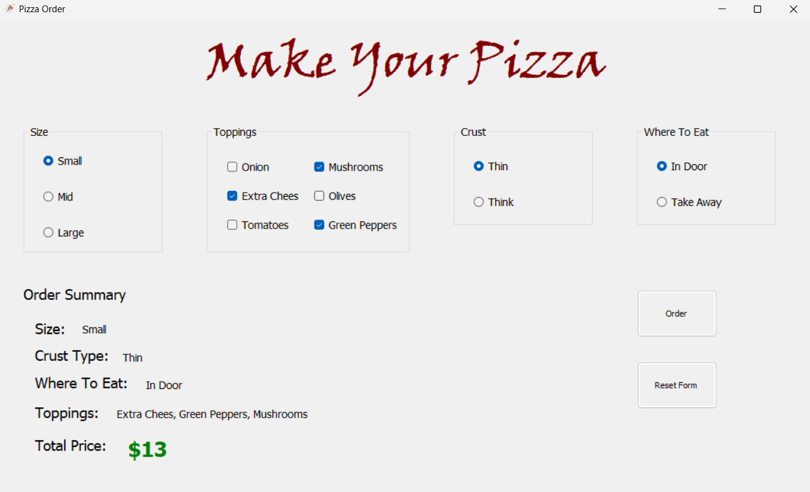

# 🍕 Pizza Order WinForm

A simple Windows Forms desktop application that lets customers build a custom pizza order and see the total price update in real time.

Built with C# and .NET Framework (WinForms).

## 📖 Overview

`FrmPizzaOrder` is a single-form application where the user selects:

- Size — Small, Mid, or Large

- Crust — Thin or Thick

- Toppings — Onion, Extra Cheese, Mushrooms, Olives, Tomatoes, Green Peppers

- Where to Eat — In Door or Take Away

Every selection instantly updates the Order Summary panel and the Total Price label. When the user confirms the order, the configuration controls are locked to prevent further changes until the form is reset.

## ✨ Features

- Live price calculation — no "Calculate" button needed

- Live order summary (size, crust, place, toppings)

- Confirmation dialog before placing the order

- Inputs are locked after a confirmed order

- One-click Reset Form to restore defaults

- Pricing stored in each control's `Tag` property, so prices can be changed from the designer without touching code

## 🖥️ Screenshot



## 📂 Project Structure

```bash
    Pizza_Order_WinForm/
    │
    ├── FrmPizzaOrder.cs           # Form logic: pricing, summaries, order/reset
    ├── FrmPizzaOrder.Designer.cs  # Auto-generated UI layout & control definitions
    ├── FrmPizzaOrder.resx         # Form resources (icon, etc.)
    ├── Program.cs                 # Application entry point
    ├── Properties/                # Assembly info & settings
    └── README.md
```

### Key methods in `FrmPizzaOrder.cs`

`CalculateTotalPrice()`: Sums size + crust + place + toppings

`GetSizePrice()`: Reads the checked size radio button's Tag

`GetCrustPrice()`: Reads the checked crust radio button's Tag

`GetEatPlacePrice()`: Reads the checked place radio button's Tag

`GetToppingsPrice()`: Sums the Tag of every checked topping

`UpdateTotalPriceLbl()`: Refreshes the total price label

`UpdateSizeLbl()` / `UpdateCrustLbl()` / `UpdateEatPlaceLbl()` / `UpdateToppingsLbl()`: Refresh the summary panel

`Reset()`: Restores all defaults and re-enables the controls

`btnOrder_Click()`: Shows a confirmation dialog and locks the form

`btnReset_Click()`: Calls `Reset()`

## 🚀 Getting Started

### Requirements

- Windows OS

- Visual Studio 2019 / 2022 (with .NET desktop development workload)

- .NET Framework 4.8

### Build & Run

1. Clone the repository:

   ```bash
       git clone https://github.com/Baraa-Mansour/Pizza-Order-WinForm.git
   ```

2. Open `Pizza Order WinForm.sln` in Visual Studio.

3. Press F5 (or Ctrl+F5) to build and run.

## 🕹️ Usage

1. Launch the app — it opens with the default configuration already selected.

2. Pick a Size, Crust, and Where To Eat.

3. Tick any Toppings you want.

4. Watch the summary and total price update as you go.

5. Click Order → confirm the dialog to place the order. All option groups become disabled.

6. Click Reset Form to start a new order.
